<div align="center">


### 👋 Hello, World! · 你好，世界！

**Developer · Builder · Open Source Enthusiast**  
**开发者 · 创造者 · 开源爱好者**

<p>
  
  
  
</p>

</div>

## 🐍 Contribution Snake · 提交记录贪吃蛇

<div align="center">


</div>

> 根据 GitHub 提交记录自动生成贪吃蛇动画，每天自动更新，也可以在 Actions 中手动运行。

## 🧑‍💻 About Me · 关于我

```yaml
name: zb479519891
role: Developer · 开发者
mindset: "Code. Create. Learn. Repeat."
         "编码 · 创造 · 学习 · 循环"
focus:
  - Clean & maintainable code · 简洁且易维护的代码
  - Practical projects · 实用项目
  - Continuous learning · 持续学习
  - Open source · 开源
```

## 🛠️ Tech Stack · 技术栈

<div align="center">


<p>Python · Java · JavaScript · TypeScript · Node.js · Git · GitHub · Linux · VS Code · Docker</p>
</div>

## 📊 GitHub Stats · GitHub 数据概览

<div align="center">

### ⚡ Coding Activity · 编码活动

<a href="https://github.com/zb479519891">

</a>
<a href="https://github.com/zb479519891">

</a>

<br><br>

### 🔥 Consistency · 持续贡献

<a href="https://github.com/zb479519891">

</a>

<br><br>


</div>

## 🧬 My Dev DNA · 我的开发者基因

> *Part engineer, part explorer, permanently under construction.*  
> *一半工程师，一半探索者，永远在施工中。*

| 🧩 Trait | What it looks like · 具体表现 |
|---|---|
| **Curiosity 驱动** | 遇到“不知道”，第一反应是动手验证。 |
| **Builder 实干派** | 想法不落地，就只是脑海里的装饰品。 |
| **Debugger 排障员** | Bug 不是个人攻击，是系统发来的谜题。 |
| **Perfectionist（适量）** | 先完成，再优化；拒绝无限打磨。 |
| **Open-minded 持续更新** | 好方法值得坚持，旧方法也可以被推翻。 |

### 🧪 Lab Rules · 实验室守则

- **Experiment > Assumption** — 少猜，多验证。
- **Small steps, real progress** — 每次推进一点，也算推进。
- **Make it work. Make it clear. Make it last.** — 先跑起来，再讲清楚，最后经得起时间。
- **Stay weird. Build useful.** — 保留自己的风格，做真正有用的东西。

<div align="center">

### CURRENT_BUILD: ME_v∞

**🔋 Energy:** Curiosity · **🧭 Direction:** Follow the problem · **♻️ Update:** Every day

**能量来源：好奇心 · 行动方向：追着问题走 · 更新频率：每天**

</div>

## 💬 Philosophy · 开发理念

<div align="center">

> **“Great software is built one small improvement at a time.”**  
> **“优秀的软件，是由一次次微小的改进构建而成的。”**

</div>

---

<div align="center">

### 🚀 Keep coding. Keep learning. Keep building.
### 🚀 持续编码 · 持续学习 · 持续创造


</div>
